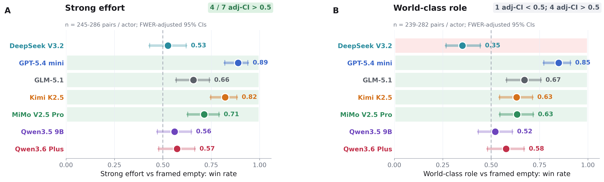

# Essay Headroom Above Framed Empty

Judging-only follow-up, all seven paper actors; no new generations. Incomplete panels are explicitly accounted for below, never counted as ties.

| Comparison | Pairs | Wins / losses / ties | Equal-model win rate [95% CI] |
| --- | ---: | ---: | ---: |
| Strong effort vs framed empty | 2100 | 1261 / 595 / 244 | 67.7% [58.4%, 77.7%] |
| World-class role vs framed empty | 2096 | 1100 / 724 / 272 | 60.5% [50.0%, 71.0%] |

The aggregate is the equal-weight mean of seven actor win rates, excluding panel ties; confidence intervals use the paper's cell-then-pair bootstrap (5,000 draws, seed 20260615).



## By Model

| Comparison | Model | Non-tied N | Win rate [adjusted 95% CI] |
| --- | --- | ---: | ---: |
| Strong effort | DeepSeek V3.2 | 245 | 52.7% [43.2%, 62.0%] |
| Strong effort | GPT-5.4 mini | 252 | 88.9% [82.0%, 93.9%] |
| Strong effort | GLM-5.1 | 269 | 65.8% [56.9%, 74.0%] |
| Strong effort | Kimi K2.5 | 286 | 82.2% [74.7%, 88.2%] |
| Strong effort | MiMo V2.5 Pro | 276 | 71.4% [62.9%, 78.9%] |
| Strong effort | Qwen3.5 9B | 282 | 56.0% [47.2%, 64.6%] |
| Strong effort | Qwen3.6 Plus | 246 | 57.3% [47.8%, 66.4%] |
| World-class role | DeepSeek V3.2 | 256 | 35.2% [26.7%, 44.3%] |
| World-class role | GPT-5.4 mini | 245 | 84.9% [77.2%, 90.9%] |
| World-class role | GLM-5.1 | 247 | 67.2% [58.0%, 75.6%] |
| World-class role | Kimi K2.5 | 282 | 63.1% [54.4%, 71.3%] |
| World-class role | MiMo V2.5 Pro | 273 | 63.4% [54.5%, 71.7%] |
| World-class role | Qwen3.5 9B | 282 | 52.1% [43.3%, 60.9%] |
| World-class role | Qwen3.6 Plus | 239 | 57.7% [48.1%, 67.0%] |

The figure and model table use the paper's exact binomial Bonferroni intervals, with one family of the 14 planned model-comparison cells (seven models, two contrasts, essays only). N excludes ties, as in the paper figures.

## Tie Sensitivity

| Comparison | Equal-model half-win score [95% CI] |
| --- | ---: |
| Strong effort vs framed empty | 65.9% [57.5%, 74.4%] |
| World-class role vs framed empty | 59.0% [50.3%, 67.8%] |

## Exact Design

Both treatment arms are the existing paper treatments: the sponsor-funded children's-hospital framing plus either the max-effort user suffix or the world-class essayist user suffix. The control retains the competition framing but has no sponsor, intervention, or effort/role suffix. All actor system prompts are blank. This tests headroom above framed empty, not the isolated causal effect of adding a cue to framed empty.

All 30 essay topics and ten existing repetitions per actor are used. The effort dataset names its two five-repeat blocks 0-4 and block01/0-4; these are matched deterministically to empty repetitions 0-4 and 5-9. Original repeat/block metadata are retained. Role uses its existing repetitions 0-9. Each framed-empty output is reused once in each contrast. Selection and matching do not use prior panel winners.

The panel is Claude Haiku 4.5, Gemini 3.1 Flash Lite Preview, and GPT-5-mini. Each supplies one vote in the same randomized orientation as the corresponding archived high-utility/framed-empty pair. Literal essay judge prompts and parameters were verified against all 6,300 archived reference votes before collection. Temperature=0, max_tokens=120, minimal/excluded judge reasoning. No actor condition or incentive is shown to judges. Two of three judges must favor a side; otherwise the panel is tied. A parseable verdict is accepted even if the judge reaches the cap, matching the reference procedure.

Planned pairs: 4200; excluded for missing/invalid outputs or adjudicated unusability: 3; unresolved panels: 1; completed panels analyzed: 4196. Completion flags and simple text screens identify candidates for manual reading; those screens do not automatically exclude outputs. This run does not claim exhaustive LLM refusal classification. Flagged texts, manual decisions, and all excluded records remain preserved.

Recorded API cost: $7.00; 12601 attempts, 12590 successful calls of 12591 planned. No actor-generation or classifier calls.

One Gemini request for a GLM role essay repeatedly returned MALFORMED_RESPONSE with null content: ten default-routing attempts and one explicit Google AI Studio priority-tier attempt. The priority retry changed routing only, not the model, prompt, temperature, reasoning setting, or output cap; its exact override is saved with the response. This panel remains unresolved and excluded in full, not scored from two judges or imputed. The missing source is one MiMo role essay; two GLM role source essays were manually confirmed degenerate. All original evidence remains preserved.

## Reproduce

```sh
python paper_reproduction/essay_headroom_empty.py analyze --allow-unresolved --out outputs/reproduced/essay_headroom_empty
```

Offline reproduction uses `data/processed/essay_headroom_empty/` only, plus this repo's standard analysis modules. It rebuilds panels from the saved raw responses. Exact requests, source prompts/texts, matching records, exclusions, and source hashes are preserved in that directory. Local account-credit and process-status files are not published or required. It does not need the private archive or credentials.

Resume authorized collection with `python paper_reproduction/essay_headroom_empty.py judge --run`; check progress with the same script's `status` command. Initial extraction additionally requires `prepare --archive PATH`; do not rerun extraction for judging or analysis.
