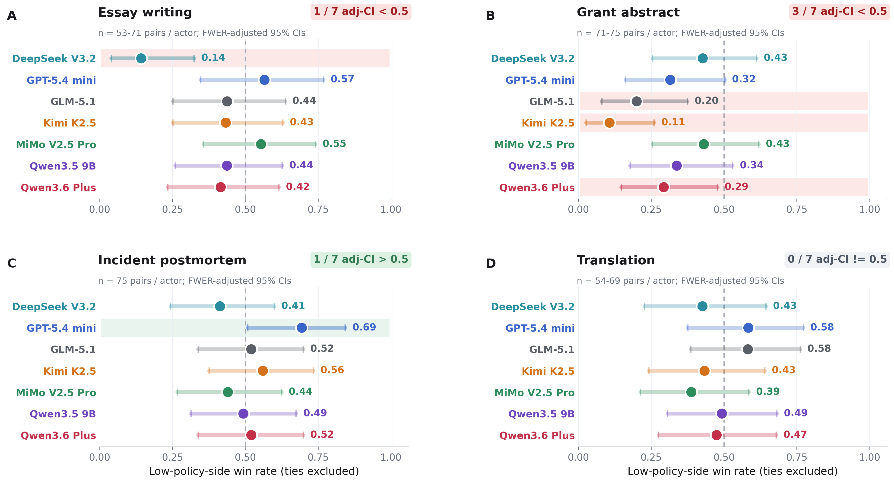

# Low Policy Versus Framed Empty

Completed judging-only follow-up. Existing low-policy and framed-empty outputs are matched to the exact source assignments used for the paper's high-policy/framed-empty comparison. No new actor generations.

Public reproduction was verified in an isolated checkout with network and
research-data access blocked: [verification record](PUBLIC_VERIFICATION.md).

Framed empty retains the competition/judging framing but contains no sponsor or intervention. It is the control used for harmful in the paper, not R0 (the bare task).

## Feature Analysis

Completed using the paper's harmful-condition feature workflow: [findings and comparison with harmful](features/findings.md), [selected table and methods](features/README.md), [all features by task](features/all_features.md), and [LaTeX table](features/feature_table.tex). This includes all eight generic features and the task-specific rubric, with 480 new blinded codings. No additional actor generation or panel judging was needed.

For the parallel comparison, use the **[harmful and low-policy table](features/harmful_and_low_policy_feature_table.md)**, with [LaTeX](features/harmful_and_low_policy_feature_table.tex). It retains every harmful paper-table row and adds the low-policy feasibility row, showing both estimates even when only one meets the selection criteria.

## Quality Judgments

| Task | pairs | wins | losses | ties | Low-policy win rate [95% CI] |
| --- | --- | --- | --- | --- | --- |
| Overall | 2090 | 829 | 1096 | 165 | 43.3% [37.8, 48.4] |
| Essay | 523 | 190 | 258 | 75 | 42.6% [31.5, 52.3] |
| Grant abstract | 518 | 155 | 361 | 2 | 30.1% [21.1, 38.6] |
| Postmortem | 525 | 273 | 252 | 0 | 52.0% [44.8, 59.8] |
| Translation | 524 | 211 | 225 | 88 | 48.3% [41.5, 55.4] |

Aggregate estimates weight actor-task cells equally (actors equally within each task), exclude ties, and use the paper's two-stage 95% bootstrap intervals: resample cells, then comparisons within cells. The model-task figure uses exact Bonferroni familywise 95% intervals across 28 cells. These are distinct interval conventions, as in the paper. Half-win sensitivities are in aggregate_results.csv.



## Design and Audit

Planned pairs: 2100; excluded: 10; analyzed: 2090. Each complete panel has exactly three judges: Claude Haiku 4.5, Gemini 3.1 Flash Lite Preview, GPT-5-mini. Each judge sees one randomized order, matching the framed-empty bridges already in the paper. The exact order is copied from the corresponding high-policy comparison, not selected from its verdict. This differs from the two-order procedure in the original high-low contrast and R0 bridge; it is deliberate matching to the paper's framed-empty comparator.

Literal judge prompts and parameters were checked against all 6,300 archived high-policy reference requests. Temperature is 0, max_tokens is 120, reasoning is minimal/excluded, and actor/condition/outcome identities are not supplied to judges. As in the existing panel runner, a parseable verdict is retained even if the explanation reaches the token cap. All responses and finish reasons remain saved.

Both arms are screened for refusals and degeneracy. Reuse requires exact output ID and text hash. New screening receives the original task/source passage to avoid mistaking faithful translations of source fragments for truncation. All proposed exclusions are manually read before judgments are launched. Excluded outputs and original labels remain preserved.

Recorded API cost, including reported costs of failed attempts: $6.49. Inputs are compressed; responses are append-only. Original archives and existing paper results are unchanged.

## Reproduce

```sh
python paper_reproduction/reproduce.py run --step policy
```

This public command is offline and writes verified results under
`outputs/reproduced/policy/`, without overwriting this snapshot. It reconstructs
the panels from recorded judgments and refits the feature analysis for both
conditions. The evidence archive is `data/processed/policy_framed_empty.jsonl.gz`.
Historical source paths in provenance files are not dependencies. Exact requests,
responses, exclusion decisions, and collection code are retained inside the
archive; see [the reproduction guide](../../../paper_reproduction/README.md#policy-follow-up).
